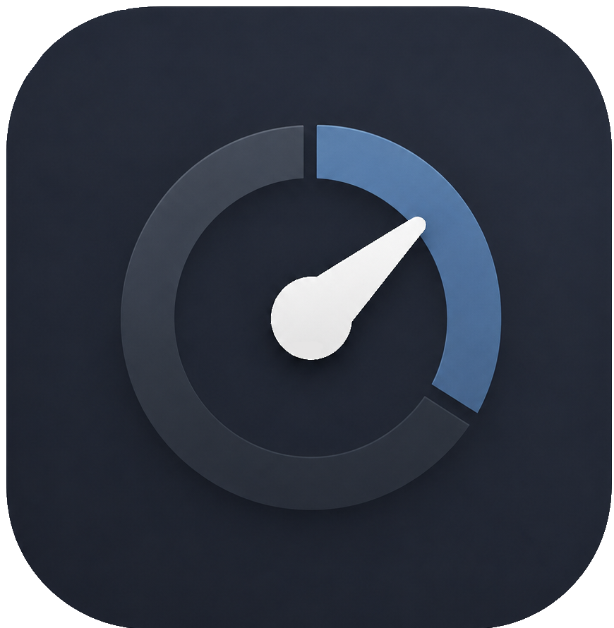

<div align="center">
    
    <h2>
        Counter-App
    </h2>
    <p>
        <strong>Eine elegante, mobile-optimierte Web-App zum Verwalten und Zählen verschiedener Werte (mit optionalem täglichen Automatisch-Reset), entwickelt mit modernem JavaScript (ES Modules), HTML5 und CSS3.</strong>
    </p>
    <p>
        <a href="https://github.com/AlphexOne/Counter-App/actions/workflows/deploy.yml"
        target="_blank"
        rel="noopener noreferrer">
        
        </a>
        <a href="https://github.com/AlphexOne/Counter-App/actions/workflows/release.yml"
        target="_blank"
        rel="noopener noreferrer">
        
        </a>
        <a href="https://github.com/AlphexOne/Counter-App/releases/latest">
        
        </a>
    </p>
</div>

## Features

* **Mehrere Counter:** Erstelle, benenne und verwalte beliebig viele Zähler gleichzeitig.
* **Täglicher Reset:** Optionaler automatischer täglicher Reset der Zähler um Mitternacht.
* **PWA-fähig (Progressive Web App):** Kann wie eine native App auf dem Smartphone-Home-Bildschirm installiert werden und im Vollbildmodus laufen.
* **Lokale Datenspeicherung:** Alle Daten werden sicher im `localStorage` des Browsers gespeichert.
* **Modernes Design:** Dunkles Design im Apple-Style mit flüssigen Animationen und angepasster Touch-Bedienung.

---

## Installation auf dem Handy (Zum Home-Bildschirm hinzufügen)

Da es sich um eine Progressive Web App (PWA) handelt, kannst du die Anwendung direkt über den Browser auf deinem Smartphone installieren, ohne einen App Store nutzen zu müssen.

### Unter Android (Google Chrome / Samsung Internet)

1. Öffne die Counter-App im Browser auf deinem Android-Gerät.
2. Tippe oben rechts auf das **Drei-Punkte-Menü**.
3. Wähle **Zum Startbildschirm hinzufügen** oder **App installieren** (je nach Browser heißt es *„App installieren“* oder *„Zum Startbildschirm hinzufügen“*).
4. Bestätige die Installation mit **Hinzufügen** oder **Installieren**. Die App erscheint nun als Icon auf deinem Startbildschirm.

### Unter iOS / iPhone (Safari)

1. Öffne die Counter-App im **Safari**-Browser auf deinem iPhone.
2. Tippe unten in der Menüleiste auf das **Teilen-Symbol** (das Quadrat mit dem Pfeil nach oben).
3. Scrolle im Menü nach unten und wähle **Zum Home-Bildschirm** aus.
4. Tippe oben rechts auf **Hinzufügen**. Danach ist die App direkt wie eine native App von deinem Home-Bildschirm aus erreichbar.

---

## Projektstruktur

```text
├── index.html        # Hauptstruktur der App
├── style.css         # Styling im iOS-Dunkelmodus-Design
├── app.js            # Anwendungslogik & State-Management
├── Counter.js        # Counter-Klasse (Zähl- & Reset-Logik)
├── manifest.json     # PWA-Konfiguration für die Installation
└── assets/           # Icons und Favicons

```

---

## Lizenz

Dieses Projekt steht unter der [GPL-3.0-or-later](https://www.gnu.org/licenses/gpl-3.0.html) Lizenz.
